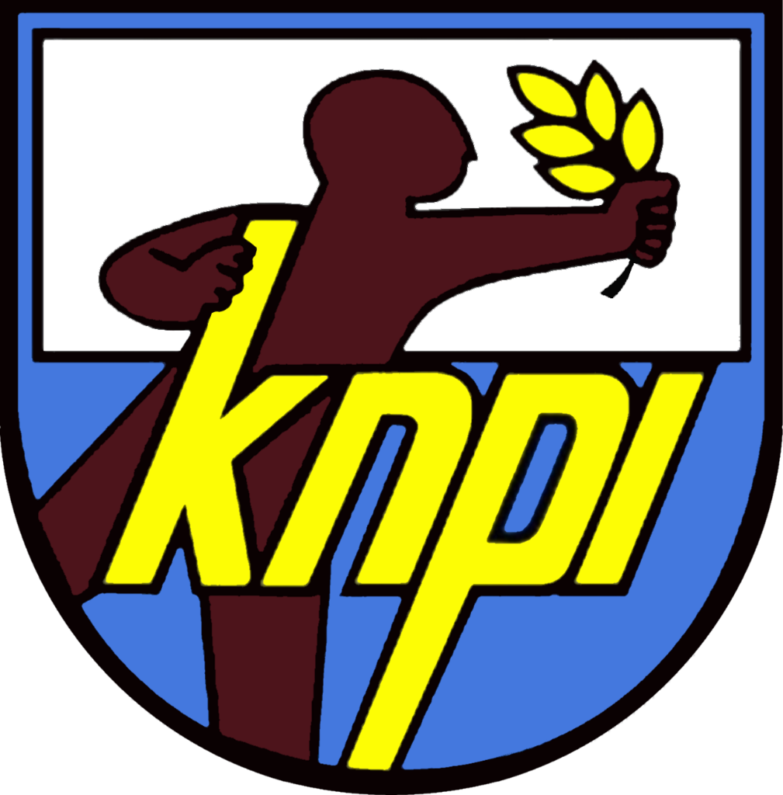

<p align="center">
  
</p>

<h1 align="center">KNPI Digital Ecosystem</h1>
<p align="center"><strong>Komite Nasional Pemuda Indonesia (DPP KNPI)</strong></p>

<p align="center">
  <a href="https://laravel.com"></a>
  <a href="https://php.net"></a>
  <a href="https://tailwindcss.com"></a>
  <a href="https://alpinejs.dev"></a>
  <a href="https://mysql.com"></a>
  <a href="#-pengujian-otomatis-test-suite"></a>
</p>

> **"Sinergi Pemuda, Membangun Bangsa Menuju Indonesia Emas"**  
> *Portal Resmi Konsolidasi Organisasi Kemasyarakatan Pemuda (OKP), Verifikasi Legalitas SK, dan Kanal e-Aspirasi Publik Terintegrasi DPP KNPI.*

---

## 📌 Daftar Isi
1. [Tentang Platform](#-tentang-platform)
2. [Spesifikasi Desain & Palet Warna](#-spesifikasi-desain--palet-warna)
3. [Arsitektur Database & Relasi ERD](#-arsitektur-database--relasi-erd)
4. [Struktur Fitur Utama](#-struktur-fitur-utama)
   - [Portal Publik (Public Civic Portal)](#1-portal-publik-public-civic-portal)
   - [Paper Admin Dashboard](#2-paper-admin-dashboard)
5. [Daftar Rute & Endpoint (Routes Map)](#-daftar-rute--endpoint-routes-map)
6. [Panduan Instalasi & Menjalankan Lokal](#-panduan-instalasi--menjalankan-lokal)
7. [Akun Pengguna Default (Seeder)](#-akun-pengguna-default-seeder)
8. [Pengujian Otomatis (Test Suite)](#-pengujian-otomatis-test-suite)

---

## 🏛 Tentang Platform

**KNPI Digital Ecosystem** adalah platform berbasis web modern yang dibangun untuk Dewan Pengurus Pusat Komite Nasional Pemuda Indonesia (DPP KNPI). Sistem ini dirancang untuk:
- Memfasilitasi pendaftaran dan verifikasi status legalitas SK (Kemenkumham/DPD) bagi seluruh Organisasi Kemasyarakatan Pemuda (OKP) di Indonesia.
- Menyediakan kanal **e-Aspirasi** publik dengan penomoran kode tiket unik bertaraf resmi (`KNPI-YYYYMM-XXXX`) serta pelacakan disposisi secara transparan.
- Mempublikasikan warta kepemudaan, siaran pers resmi, dan kalender kegiatan/agenda forum dialog nasional dengan kuota peserta mandiri.

---

## 🎨 Spesifikasi Desain & Palet Warna

Platform menerapkan 2 pendekatan desain spesifik sesuai arahan SRS & UI Wireframe:

| Elemen | Kode Warna (HEX) | Penggunaan |
| :--- | :--- | :--- |
| **Royal Blue** | `#0B3B82` / `#0F4C81` | Brand identity utama, header hero, tombol primer, dan identitas resmi civic. |
| **Gold Accent** | `#F59E0B` / `#D97706` | Aksen visual dinamis, tombol kirim aspirasi, call-to-action, dan penanda highlight. |
| **Slate Gray** | `#64748B` / `#334155` | Tipografi sekunder, metadata tanggal, dan border halus table (`border-slate-200`). |
| **Paper White** | `#F8FAFC` / `#FFFFFF` | Background kanvas Paper Admin, card container, dan form canvas. |

- **Public Civic Portal**: Authoritative civic aesthetic, mobile-first, navigasi sticky dengan topbar sekretariat, dan layout kartu bergradasi halus.
- **Paper Admin Dashboard**: Minimalist Paper aesthetic, high data density, border halus 1px tanpa gradien berlebihan, responsive fixed sidebar, dan quick-action modal.

---

## 🗄 Arsitektur Database & Relasi ERD

Sistem mengimplementasikan 10 entitas Eloquent dengan tipe data modern Laravel 11:

```
[USERS] (role: super_admin, admin_humas, admin_okp)
   │
   ├─► (writes/author) ──► [ARTICLES] ◄── (categorizes) ── [CATEGORIES]
   │
   └─► (handled_by) ────► [ASPIRATIONS] (ticket: KNPI-YYYYMM-XXXX)

[EVENTS] ───────────────► [EVENT_REGISTRATIONS] (NIK, OKP Origin, Quota)
[ORGANIZATIONS] (OKP)   ─ (name, leader_name, sk_number, sk_file PDF, status: pending/verified/expired)
[GALLERY_ALBUM] ────────► [GALLERY_ITEM] (photos/videos)
[OFFICIALS]              ─ (Dewan Pengurus Pusat, sort_order)
```

---

## 🚀 Struktur Fitur Utama

### 1. Portal Publik (Public Civic Portal)
- **Hero Section**: Headline *"Sinergi Pemuda, Membangun Bangsa Menuju Indonesia Emas"*, aksen wedge emas diagonal, dan CTA ganda.
- **4-Column Metric Strip**: Indikator *Quick Stats OKP*, *Youth News*, *Youth Agenda*, dan *Verifications*.
- **Featured Youth News**: 3 kartu berita terpopuler dengan thumbnail, badge kategori, dan waktu tayang.
- **Registered OKP Showcase**: Kartu OKP dengan lencana verifikasi hijau `✓ Terverifikasi`.
- **Upcoming Agenda**: Kalender kegiatan pemuda dengan informasi sisa kuota dan modal pendaftaran instan.
- **e-Aspirasi Widget Box**: Formulir pengaduan dengan validasi ketat, unggah lampiran dokumen, penomoran tiket otomatis, serta kotak pencarian tiket (`/aspirasi/lacak`).

### 2. Paper Admin Dashboard
- **Aggregate Metrics**: Total OKP aktif, OKP butuh verifikasi, total tiket aspirasi, dan artikel publikasi.
- **Recent OKP Verification Table**: Tabel data padat dengan aksi verifikasi instan status (`pending`, `verified`, `expired`), input nomor SK, dan unggah dokumen PDF.
- **Active Youth Aspiration Ticket Manager**: Disposisi tiket, perubahan status (`submitted`, `in_review`, `resolved`), dan penulisan catatan resmi pengurus.
- **Content Management**: Resource CRUD untuk Berita Kepemudaan dan Agenda Kegiatan.

---

## 🗺 Daftar Rute & Endpoint (Routes Map)

### Public Routes
| Method | URI | Controller Action | Deskripsi |
| :--- | :--- | :--- | :--- |
| `GET` | `/` | `HomeController@index` | Halaman utama / Landing Page |
| `GET` | `/berita` | `ArticleController@index` | Katalog seluruh warta pemuda & filter kategori |
| `GET` | `/berita/{slug}` | `ArticleController@show` | Detail baca berita + increment views |
| `GET` | `/okp` | `OrganizationController@index` | Direktori publik OKP & pencarian legalitas |
| `GET` | `/agenda` | `EventController@index` | Daftar agenda & kalender kegiatan pemuda |
| `POST` | `/agenda/{event}/register` | `EventRegistrationController@store` | Pendaftaran partisipan kegiatan |
| `POST` | `/aspirasi` | `AspirationController@store` | Submit aspirasi + generate kode tiket unik |
| `GET` | `/aspirasi/lacak` | `AspirationController@track` | Pelacakan progres status & respon tiket |
| `GET` | `/login` | `AuthController@showLoginForm` | Portal masuk otentikasi pengurus |
| `POST` | `/login` | `AuthController@login` | Proses autentikasi login |
| `POST` | `/logout` | `AuthController@logout` | Sesi keluar admin |

### Admin Routes (`/admin` prefix + `auth` middleware)
| Method | URI | Controller Action | Deskripsi |
| :--- | :--- | :--- | :--- |
| `GET` | `/admin/dashboard` | `Admin\DashboardController@index` | Paper Admin Dashboard & metrik |
| `GET` | `/admin/okp` | `Admin\OrganizationController@index` | Manajemen direktori OKP & filter status |
| `GET` | `/admin/okp/create` | `Admin\OrganizationController@create` | Form tambah data OKP baru |
| `POST` | `/admin/okp` | `Admin\OrganizationController@store` | Simpan data OKP & berkas SK |
| `PATCH`| `/admin/okp/{organization}/verify` | `Admin\OrganizationController@verify` | **Custom Action:** Verifikasi status SK OKP |
| `GET` | `/admin/aspirasi` | `Admin\AspirationController@index` | Tiket manager aspirasi pemuda |
| `PATCH`| `/admin/aspirasi/{aspiration}` | `Admin\AspirationController@update` | Update status & rilis catatan resmi |
| `RESOURCE` | `/admin/berita` | `Admin\ArticleController` | CRUD artikel warta pemuda |
| `RESOURCE` | `/admin/agenda` | `Admin\EventController` | CRUD agenda & daftar hadir peserta |

---

## 💻 Panduan Instalasi & Menjalankan Lokal

### Prasyarat
- PHP 8.2 atau lebih baru (ekstensi `pdo_mysql`, `mbstring`, `fileinfo` aktif)
- Composer 2.x
- MySQL 8.0+

### Langkah-langkah Setup

1. **Clone Repositori & Masuk Direktori**
   ```bash
   git clone https://github.com/wendiNurhermansah/knpi-organitation.git
   cd knpi-organitation
   ```

2. **Instal Dependensi PHP (Composer)**
   ```bash
   composer install
   ```

3. **Konfigurasi Environment File (`.env`)**
   Sesuaikan konfigurasi database MySQL:
   ```env
   DB_CONNECTION=mysql
   DB_HOST=127.0.0.1
   DB_PORT=3306
   DB_DATABASE=knpi
   DB_USERNAME=root
   DB_PASSWORD=
   ```

4. **Generate Application Key**
   ```bash
   php artisan key:generate
   ```

5. **Migrasi Database & Seeder Data Awal**
   ```bash
   php artisan migrate:fresh --seed
   ```

6. **Hubungkan Storage Symlink (Untuk Upload Dokumen SK & Lampiran)**
   ```bash
   php artisan storage:link
   ```

7. **Jalankan Server Lokal**
   ```bash
   php artisan serve
   ```
   Akses aplikasi pada peramban web di: `http://127.0.0.1:8000`

---

## 👥 Akun Pengguna Default (Seeder)

Untuk keperluan pengujian login admin, database seeder menyediakan 3 akun dengan role berbeda:

| Role | Email | Password | Hak Akses |
| :--- | :--- | :--- | :--- |
| **Super Admin** | `admin@knpi.or.id` | `password123` | Akses penuh seluruh sistem, verifikasi OKP, dan disposisi tiket aspirasi |
| **Admin Humas** | `humas@knpi.or.id` | `password123` | Manajemen publikasi berita, rilis pers, dan agenda kegiatan |
| **Admin OKP** | `okp@knpi.or.id` | `password123` | Kurasi data OKP dan verifikasi nomor legalitas SK |

---

## 🧪 Pengujian Otomatis (Test Suite)

Seluruh logika bisnis, form request, middleware keamanan, dan controller action telah diuji menggunakan automated feature tests pada file [tests/Feature/KnpiEcosystemTest.php](file:///d:/Data%20Wendi/WN-OFFICIAL/projek%20APK/knpi/tests/Feature/KnpiEcosystemTest.php).

Jalankan pengujian kapan saja dengan perintah:
```bash
php artisan test --filter=KnpiEcosystemTest
```

**Hasil Pengujian:**
```text
   PASS  Tests\Feature\KnpiEcosystemTest
  ✓ landing page renders with hero and metrics
  ✓ public articles index and show
  ✓ public okp directory
  ✓ agenda listing and registration
  ✓ aspiration submission generates ticket and tracks
  ✓ admin dashboard requires auth and renders metrics
  ✓ admin can verify okp
  ✓ admin can update aspiration ticket

  Tests:    8 passed (35 assertions)
  Duration: 17.38s
```

---

## 📜 Lisensi & Hak Cipta
Hak Cipta © 2026 **Dewan Pengurus Pusat Komite Nasional Pemuda Indonesia (DPP KNPI)**.  
Dikembangkan untuk modernisasi ekosistem kepemudaan nasional menuju **Indonesia Emas 2045**.
